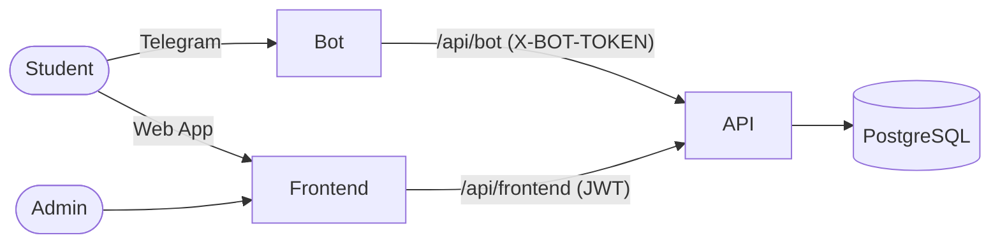

# Ip-Deputy

A personal assistant for a university student group: a Telegram bot with the schedule, teachers, links and lab-work defence queues, plus an admin panel to manage all of it.

| Repository | Stack | Description |
|---|---|---|
| [Ip-Deputy-Api](https://github.com/Navatusein/Ip-Deputy-Api) | .NET 10, ASP.NET Core, EF Core, PostgreSQL | REST API, the single source of truth |
| [Ip-Deputy-Bot](https://github.com/Navatusein/Ip-Deputy-Bot) | Python 3.13, aiogram 3 | Telegram bot (uk / ru / en) |
| [Ip-Deputy-Frontend](https://github.com/Navatusein/Ip-Deputy-Frontend) | Next.js 16, React 19, Ant Design 6 | Admin panel and Telegram Web App pages |

## Architecture



- **API**: thin controllers, services and repositories. EF Core migrations are applied on startup. Admin users have a flat list of permissions, and students sign in to the Web App through Telegram `initData`.
- **Bot**: works in webhook mode. It reads the schedule and student settings from the API and shows them in the user's language.
- **Frontend**: one CRUD widget for every admin page, with server-side pagination, search and filters. Create, edit and copy forms open in drawers.

## Getting started

```bash
git clone --recurse-submodules https://github.com/Navatusein/Ip-Deputy.git
cd Ip-Deputy
cp .env.example .env
docker compose up -d
```

If the repository is already cloned, fetch the submodules with `git submodule update --init --recursive`.

The compose file runs PostgreSQL, the API, the bot and the frontend. A reverse proxy is expected in front of them:

| Public path | Service |
|---|---|
| `https://<FRONTEND_URL>/api/*` | `api:8080` |
| `https://<FRONTEND_URL>/*` | `frontend:80` |
| `https://<BOT_WEBHOOK_URL><BOT_WEBHOOK_PATH>` | `bot:7540` |

The first admin is created from `INITIAL_ADMIN_LOGIN` / `INITIAL_ADMIN_PASSWORD` when the users table is empty.

## Releases

Each repository has the same workflows:

- **CI** runs on every push and pull request.
- **Docker** pushes `dev`, `dev-latest` and `dev-<sha>` images to GitHub Container Registry (`ghcr.io/navatusein/ip-deputy-api`, `-bot`, `-frontend`) on every push to `dev`.
- **Release** is started manually from `main` with a patch, minor or major bump. It creates the `vX.Y.Z` tag, a GitHub release with the changelog, and pushes the `X.Y.Z`, `X.Y`, `X` and `latest` images.

## License

[MIT](LICENSE)
